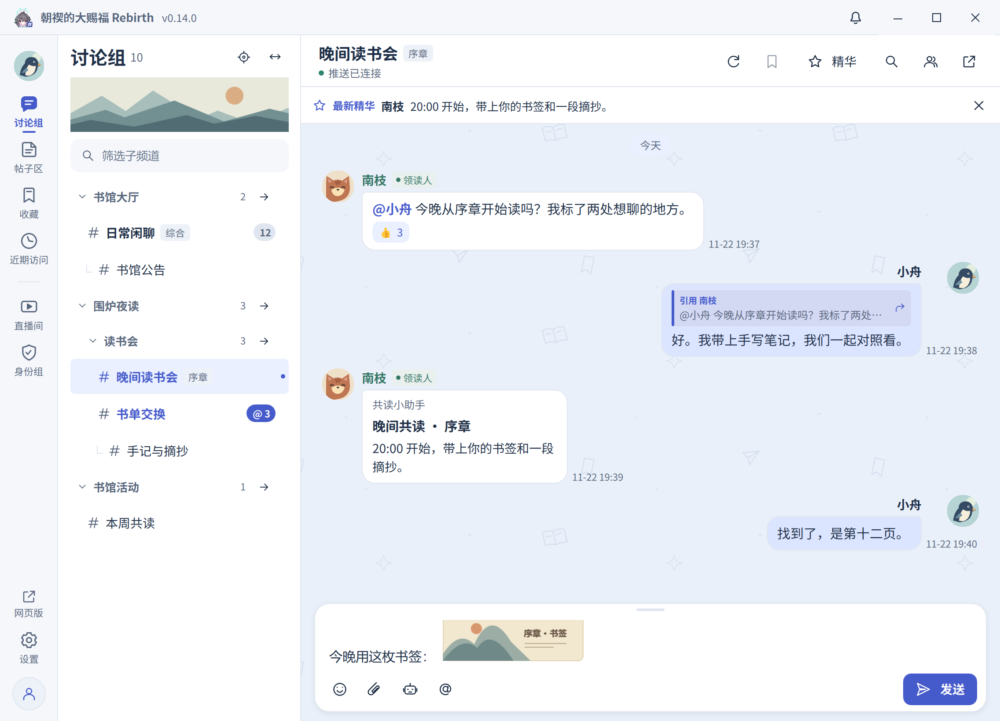

# 朝禊的大赐福 · Rebirth

朝频大赐福自用定制客户端。用 Windows 在「朝禊的大赐福」读帖子、聊讨论组，不必为了回一条消息再拿起手机。

**[下载 Windows x64 0.14.1（ZIP）](https://github.com/AsaMisogi/Asogi-QQ-Channel-Windows-Update/releases/download/v0.14.1/asogi-channel-v0.14.1-windows-x64.zip)**　·　[百度网盘](https://pan.baidu.com/s/11q33a4dF3X1YvXK5_pTFlA?pwd=nyt1)（提取码 **nyt1**）　·　[频道网页版](https://pd.qq.com/g/Nekuso0721)

另看：[后院（综合2）实景](images/courtyard.png) · [公告板帖子区实景](images/forum.png)。截图保留原来的消息、时间和版面，仅遮蔽成员信息及附件。

## 第一次使用

1. **完整解压**下载的 ZIP，打开文件夹里的 `asogi-channel.exe`。如果从 Release 页面下载，请选择 **asogi-channel-v0.14.1-windows-x64.zip**，不要选 GitHub 自动生成的 Source code。
2. 可以先作为访客阅读。要聊天，请登录 QQ；尚未加入频道的账号可以点「加入该频道」。已入频的账号按本人的房间权限收发消息。
3. 更新时先从托盘退出旧版，再解压并打开新版。**同机更新不用搬数据**：各版本共用 `%LOCALAPPDATA%\AsogiGuild`。到「设置 → 数据与备份」可以打开这个目录，或按需导出和导入备份。

## Rebirth 0.14.1 · 2026-11-22

**不直连 GitHub 也能查更新。** 当直连较慢或失败时，客户端会转向频道的香港更新入口。它读取同一份 GitHub 正式 Release；有新版时可以直接选择百度网盘下载。香港入口不传安装包，也不接收账号或聊天内容。

## Rebirth 0.14.0 · 2026-11-22

- **启动时检查更新。** 有新版时显示版本号和下载入口；在「设置 → 关于」可以手动检查，也可关闭自动检查。客户端读取 GitHub 正式版页面的跳转，不使用 GitHub 公共 API。
- **让聊天身份显示得更准确。** 已加入频道但没有身份组时不显示「访客」；点击自己的头像即可查看个人资料。
- **通过「里武林」传信。** QQ 发送失败或结果未知时，可以手动选择备用通道。备用消息成功后只保留备用气泡，不再叠着一条本地失败记录。它只分发给当时在线且订阅该讨论组的设备，离线后不补发。
- **版本和入口更好找。** 标题栏显示当前版本；侧栏可直达频道网页版。「关于」里可以找到作者主页、频道地址和微信赞赏码。

[查看最新 Release](https://github.com/AsaMisogi/Asogi-QQ-Channel-Windows-Update/releases/latest) · [查看全部版本](https://github.com/AsaMisogi/Asogi-QQ-Channel-Windows-Update/releases)

作者：[朝禊ASOGI](https://space.bilibili.com/315312)。本客户端基于 QQ 频道，仅供学习自用，频道版权归腾讯所有。本仓库只提供下载、截图与更新日志。
