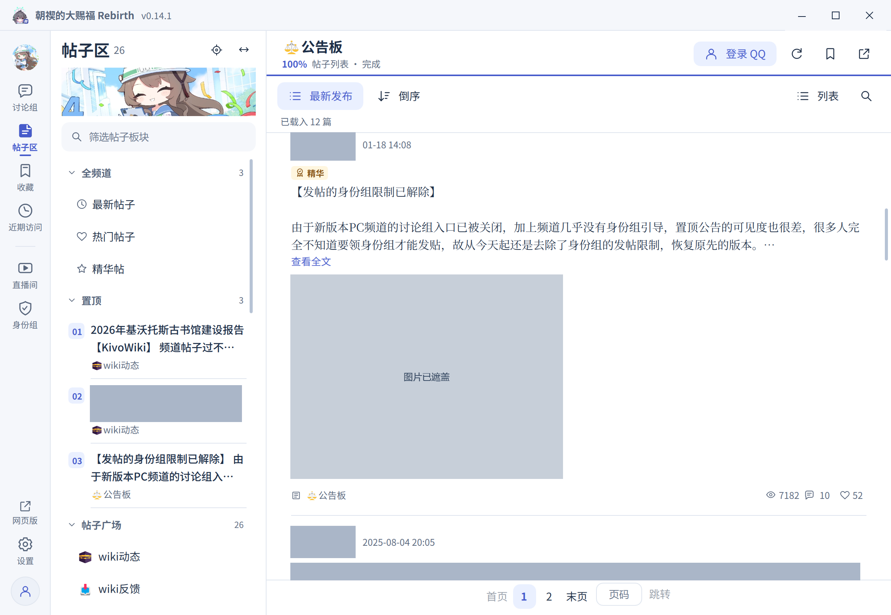
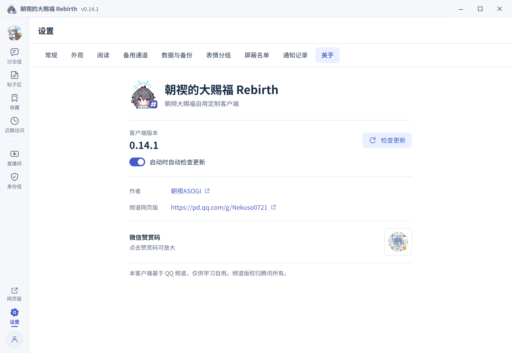

# 朝禊的大赐福 · Rebirth

朝频大赐福自用定制客户端。用 Windows 在「朝禊的大赐福」读帖子、聊讨论组，不必为了回一条消息再拿起手机。

**[下载 Windows x64 0.21.0（ZIP）](https://github.com/AsaMisogi/Asogi-QQ-Channel-Windows-Update/releases/download/v0.21.0/asogi-channel-v0.21.0-windows-x64.zip)**　·　[国内加速下载](https://gh-proxy.org/https://github.com/AsaMisogi/Asogi-QQ-Channel-Windows-Update/releases/download/v0.21.0/asogi-channel-v0.21.0-windows-x64.zip)　·　[百度网盘](https://pan.baidu.com/s/11q33a4dF3X1YvXK5_pTFlA?pwd=nyt1)（提取码 **nyt1**）　·　[频道网页版](https://pd.qq.com/g/Nekuso0721)

另看：[后院（综合2）实景](images/courtyard.png) · [公告板帖子区实景](images/forum.png)。截图保留原来的消息、时间和版面，仅遮蔽成员信息及附件。

## 第一次使用

1. **完整解压**下载的 ZIP，打开文件夹里的 `asogi-channel.exe`。如果从 Release 页面下载，请选择 **asogi-channel-v0.21.0-windows-x64.zip**，不要选 GitHub 自动生成的 Source code。
2. 可以先作为访客阅读。要聊天，请登录 QQ；尚未加入频道的账号可以点「加入该频道」。已入频的账号按本人的房间权限收发消息。
3. 0.15.1 或更早版本需从托盘退出，再完整解压本版一次。之后在「设置 → 关于」里下载更新并重启。**同机更新不用搬数据**：各版本共用 `%LOCALAPPDATA%\AsogiGuild`。到「设置 → 数据与备份」可以打开这个目录，或按需导出和导入备份。

## Rebirth 0.21.0 · 2026-11-27

- **彻底修复 Discord 桥接运行中刷不出最新消息的问题**：根治首次网络瞬断宽限期内重连调度跳过、HTTP 发信掩盖 WebSocket 假死与服务端写异常导致僵尸连接等问题；新增重连增量补拉与服务端房间消息缓存，断网恢复或机器人重连后自动补齐空窗消息，不再需要重启客户端。
- **迁移至独立中转域名 `qqrelay.asogi.fun`**：备用通道（里武林）、Discord 桥接与香港更新入口全面切换至 `qqrelay.asogi.fun`，与博客站点解耦，并接入服务端消息缓存与统一运维体系。
- **「设置 → 外部中转」全新升级**：原「备用通道」更名为「外部中转」，一页查看备用通道与 Discord 桥接的实时连接状态，支持随时在本机独立关闭/开启、断开或重连两项服务。

## Rebirth 0.20.2 · 2026-11-27

- **腾讯频道网页自动发现与安全自适配**：适配最新 `0318b043` 构建，并内置自动资源发现与明文业务指纹校验机制——今后腾讯频道网页发布常规更新时客户端可自动识别并校验通过，告别「腾讯网页版本已更新，请使用频道网页」的频繁中断；遇到破坏性接口改版仍安全阻断，绝不误操作。
- **弱网与冷启动体验大幅优化**：修复切网或动态模块加载中断未触发自动重试与离线本机阅读的问题；冷启动与网络恢复等待更平滑，普通网络闪断改用指数退避（数秒内快速自愈），不再动辄空等 30~60 秒。

## Rebirth 0.20.1 · 2026-11-26

- Discord 外部频道发消息后先在时间线显示本地发送中气泡，送达后原地切换为正式消息并短暂提示「已送达」；发送失败保留气泡，可直接点「重试」（沿用原发送编号，不重复投递）或「移除」，右键菜单同步支持。
- 修复在 Discord 调整桥接频道内容可见性（如年龄限制/NSFW）后客户端显示「正在等待 Discord 连接」且无法发消息的问题，并支持引用回复时继续附图或发收藏表情。
- 修复外部频道点击表情按钮弹出空白的问题，现在可直接打开「本机收藏」与「QQ 收藏」发送本地图片和动图（隐藏无法发往 Discord 的 QQ 系统表情）。
- 桥接子频道名与 Discord 侧保持实时同步，连不上时自动回退为固定名称；顶部「邀请」按钮更名为「加入dc」。
- 优化弱网重连与状态反馈：减少短暂抖动误判，实时推送重连期间不再锁死输入，任意请求成功后自动清理陈旧提示并唤醒重连，离线提示栏新增「立即重连」。

## Rebirth 0.20.0 · 2026-11-26

- 「讨论组 → 外部频道」现在有 A、B 两个独立文字房间，C 区按主题浏览、发帖和回复。「打开 Discord」直达本区或当前主题；邀请新成员用旁边的「邀请」。
- 启动时按桥接压力补最近 5～30 条消息，并与本地记录去重。正常运行不轮询历史，弱网重连也不会反复把同一批消息刷到屏幕上。
- 视频预览和窗口共用本地缓存，显示下载进度和速度，窗口可以另存为。图片查看器新增「实际大小」，高 DPI 屏上也可按 1:1 查看。
- 已有表态在悬停、按下时给出反馈；本机发言显示当前客户端头像。宽窗口可收起左侧列表专心聊天，Windows 主窗口支持边缘贴靠。

## Rebirth 0.19.0 · 2026-11-25

- 已入频成员可以从「讨论组 → 外部频道 → 大赐福桥接-a区」和 Discord 群友聊天，点标题栏的「打开 Discord」可前往服务器邀请页。客户端发到 Discord 的消息以 **【频道昵称】：** 单独署名，正文从下一行开始；普通 QQ 讨论组不参与桥接。
- 在引用按钮旁选表态，可用标准表情和本服务器的自定义表情；点已有表态即可加入或取消。右键头像可 @，点名字可查看 Discord 资料和最高身份组。
- 图片、动态表情和贴纸直接显示，重复的附件链接只保留一份。视频支持消息内播放和独立窗口；文件、PSD 和 PSB 选好保存位置后才下载，并显示进度和速度。发往 Discord 的图片转为 WebP，动图保留动画。

## Rebirth 0.18.0 · 2026-11-23

- 「发布帖子」可直接选图或粘贴，支持纯图和多图，不必打开网页。未获发布确认时保留草稿。
- 帖子列表、卡片、瀑布流和正文相册中的 GIF 可直接播放；滚出视口即暂停，也跟随媒体动画设置。
- 讨论组目录和收藏不再给「娱乐」「现实」这类折叠标题显示消息预览，普通子频道的预览和未读提示保持不变。

## Rebirth 0.17.0 · 2026-11-23

- 讨论组目录和收藏的子频道会显示最新发言的成员名、内容与时间，不必进房，也不会清除未读。要恢复紧凑目录，可在「设置 → 常规 → 显示」关闭「子频道和收藏显示最新消息」。
- QQ 登录确认后自动收起登录窗口。后台网页身份发生变化时，客户端会用原档案重新确认；仍有效的会话可自行恢复，真实退出仍需登录。
- 修复从网页粘贴图片时，HTML 缩进或选区外内容在草稿开头变成多余换行的问题，保留原有图文次序和显式换行。
- 修复退出时链接卡片仍在下载，后台结果晚到导致的 Qt 异常。

## Rebirth 0.16.1 · 2026-11-23

- 表情面板从左到右是「本机收藏」「QQ 收藏」「QQ 表情」。QQ 收藏默认按本机文件创建时间倒序；在「设置 → 表情分组」可恢复修改时间倒序。
- 今天的聊天消息默认只显示时分。在「设置 → 外观 → 消息时间」可恢复月日。
- 收藏行悬停覆盖到行尾。子频道显示未读数及 @ / 回复，帖子板块提示新帖，收藏原帖提示新回复；点进对应内容后消除提示。
- 修复时间线重新排版时气泡和头像一起跳动，以及后台换头像地址时短暂退回昵称首字的问题。

## Rebirth 0.16.0 · 2026-11-22

**更新不用再手动解压。** 软件会显示需下载的增量补丁或完整包大小；校验完成后点「重启并更新」。默认优先国内加速，也可固定使用 GitHub。补丁是软件专用附件，请不要手动解压覆盖。

## Rebirth 0.15.1 · 2026-11-22

从 0.14.1 升级，本版包含 0.15.0 测试期间的功能与后续修复。

- **图文可以一起复制。** 右键「复制整条消息」，可将图片、文字和换行一起粘贴。Obsidian 会得到排好版的 PNG；如果目标应用只贴出「[图片]」，选「复制为整张图片」。只想要原图或动图时，仍可单独复制图片。
- **回看聊天不丢位置。** 一次最多读取 100 条连续的本机记录。上翻补入旧消息、链接卡补出大图时，正在读的那行留在原位。鼠标按住背景拖动默认关闭，可在「设置 → 常规」开启。
- **云端不可见，本机仍可读。** 已收到的正文和已保存的原图独立于阅读缓存。QQ 明确撤回或隐藏后显示「仅本机」；点击标记可以手动通过「里武林」向同房间在线接收端传信，不会重发到 QQ。备用通道回执显示已确认数与本次接收端总数。
- **输入与引用更方便。** 输入框随换行增高，引用条显示原句和小缩略图，点 × 取消。Markdown 编辑器支持粘图：本客户端显示排版，普通 QQ 显示源码和原图。回复通知可显示发送者、内容摘要和头像。
- **图片与表情按需加载。** 修复透明头像闪烁和帖子作者头像暂时只剩底色。QQ 收藏随滚动加载，重开面板保留位置。链接缩略图完整显示；X 匿名嵌入被拒时尝试读取原帖公开图片，取不到则显示作者、限制说明及原帖入口。
- **主题和排障。** 「设置 → 外观 → 跟随系统」可随 Windows 切换亮色和深色。遇到问题时可在「设置 → 常规」开启本机调试日志，再复现一次。

## Rebirth 0.14.1 · 2026-11-22

**不直连 GitHub 也能查更新。** 当直连较慢或失败时，客户端会转向频道的香港更新入口。它读取同一份 GitHub 正式 Release；有新版时可以直接选择百度网盘下载。香港入口不传安装包，也不接收账号或聊天内容。

## Rebirth 0.14.0 · 2026-11-22

- **启动时检查更新。** 有新版时显示版本号和下载入口；在「设置 → 关于」可以手动检查，也可关闭自动检查。客户端读取 GitHub 正式版页面的跳转，不使用 GitHub 公共 API。
- **让聊天身份显示得更准确。** 已加入频道但没有身份组时不显示「访客」；点击自己的头像即可查看个人资料。
- **通过「里武林」传信。** QQ 发送失败或结果未知时，可以手动选择备用通道。备用消息成功后只保留备用气泡，不再叠着一条本地失败记录。它只分发给当时在线且订阅该讨论组的设备，离线后不补发。
- **版本和入口更好找。** 标题栏显示当前版本；侧栏可直达频道网页版。「关于」里可以找到作者主页、频道地址和微信赞赏码。

[查看最新 Release](https://github.com/AsaMisogi/Asogi-QQ-Channel-Windows-Update/releases/latest) · [查看全部版本](https://github.com/AsaMisogi/Asogi-QQ-Channel-Windows-Update/releases)

作者：[朝禊ASOGI](https://space.bilibili.com/315312)。本客户端基于 QQ 频道，仅供学习自用，频道版权归腾讯所有。本仓库只提供下载、截图与更新日志。
